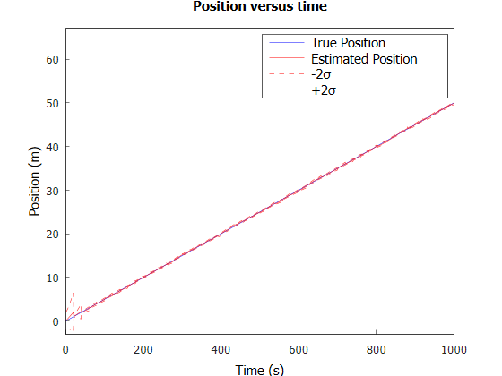
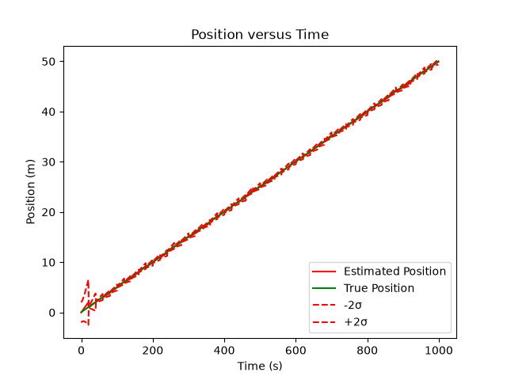
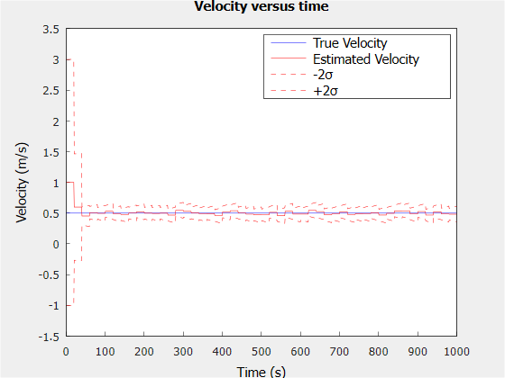
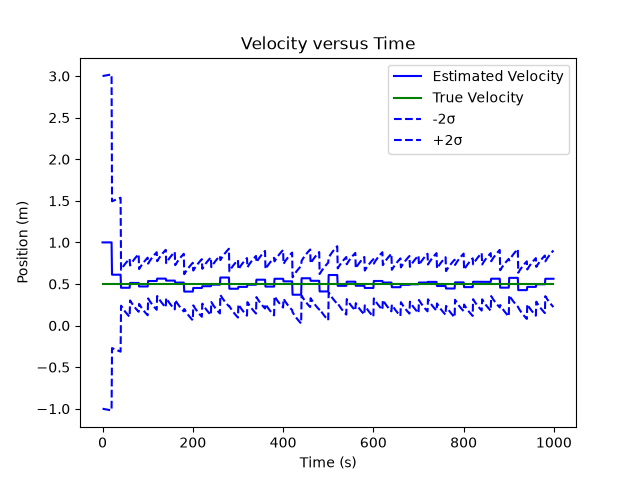

# Kalman Filter

> **Work in Progress**

This project implements a Kalman filter in C++ to estimate the position and velocity of a moving object from noisy measurements.

The filter uses **Eigen** for matrix operations and **Matplot++** for visualization. The current model tracks a two-state system consisting of position and velocity and performs prediction and measurement update steps.

## Features

- Position and velocity state estimation
- Prediction and measurement update steps
- Gaussian measurement noise
- Covariance and uncertainty tracking
- ±2σ uncertainty bounds
- Position and velocity visualization
- Python implementation included for comparison

## Position Results

### C++


### Python


## Velocity Results

### C++


### Python


## Dependencies

- C++17
- Eigen
- Matplot++

## Read ISS ephemeris measurements

These commands build and run the parser on macOS with Eigen and Matplot++ installed through Homebrew.

```sh
c++ -std=c++17 main.cpp KalmanFilter.cpp DataFile.cpp \
  -I"$(brew --prefix eigen)/include/eigen3" \
  -I"$(brew --prefix matplotplusplus)/include" \
  -L"$(brew --prefix matplotplusplus)/lib" -lmatplot -o main
./main "ISS OEM J2K EPH.txt"
```

Each output row contains the timestamp followed by `x y z vx vy vz`. The timestamp is copied verbatim, including fractional seconds. The supplied ISS file uses UTC. Position and velocity retain their OEM units of kilometers and kilometers per second. [CCSDS Orbit Data Messages, §6.6.2](https://ccsds.org/Pubs/502x0b2s.pdf)

C++ callers can use `DataFile{}.data_parser(path)` to get a vector of records with `.timestamp` and `.state` fields. Run `./main` without a file argument to start the existing simulation.

## Future Work

- Integrate the Kalman filter with physical hardware
- Process real-time sensor measurements
- Run the filter on embedded hardware such as a Raspberry Pi
- Compare C++ and Python implementations using real sensor data
- Measure execution time and communication latency
- Expand the model to additional states and sensors
- Improve visualization and filter tuning

## Status

This project is currently in progress. The current implementation focuses on simulated position and velocity measurements. Future development will transition the filter toward real-time hardware integration and sensor-based measurements.
